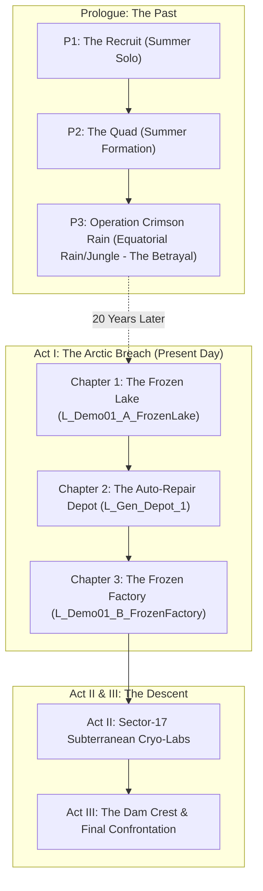

# Codex Tactics: Narrative Bible (Core Premise, Lore & Mission Flow)

> **Document Version:** 1.0.0  
> **Date:** November 2026  
> **Status:** Draft / Proposal for Creative Director Review  
> **Target Systems:** Codex Tactics (Unreal Engine 5.8)  
> **Tone & Aesthetic:** Homage to *Gorky 17* (*Odium*) — dry, tense, bleak, cynical, claustrophobic military realism, psychological trauma, sub-zero survival.

---

## 1. Executive Summary & Logline

### 1.1 High-Concept Logline
> Twenty years after being betrayed, wounded, and left to rot in a foreign jungle by their comrade-turned-warlord Sergey Roninov, three broken military veterans are contracted by a clandestine state rapid-response bureau (ГБР) to infiltrate an arctic exclusion zone and execute their former brother-in-arms along with his diamond-funded private military corporation.

### 1.2 Core Premise
Twenty years ago, a tight-knit four-man tactical unit undertook black-ops deployments across geopolitical hotspots. The unit was bound by blood and unyielding discipline: Andrey Sallivanov ("Sally"), Pavel Yatsina ("Roger"), Marat Babaev ("Babai"), and Sergey Roninov ("Ronin"). 

During a classified escort and extraction mission in a rain-drenched equatorial theater, Ronin committed the unthinkable. Driven by greed and sociopathic ambition, he orchestrated a massacre of local civilians and allied guards to seize a fortune in uncut conflict diamonds. He betrayed his unit's coordinates to hostiles, sabotaged their heavy transport, and abandoned his comrades in a lethal crossfire. The three survivors were severely wounded, endured months of torture and captivity in rebel pit-cages, and were eventually discarded back into civilian obscurity—crippled by chronic pain, post-traumatic stress disorder (PTSD), and survivor's guilt.

Ronin used his diamond empire to build **PMC "Ronin"**—a state-of-the-art, high-tech private military enterprise operating with impunity across global gray zones.

In the present day, PMC Ronin has occupied a classified, mothballed Soviet-era research enclave and hydroelectric dam complex located within an arctic perimeter ("Sector-17"). Satellite recon and intercepted comms confirm Ronin's direct personal presence. The state rapid-response directorate (ГБР) cannot officially commit standing armed forces without triggering catastrophic geopolitical fallout. Instead, they enlist the three aging veterans as disposable, deniable contractors. For the state, it is an expendable black-ops cleanup. For Sally, Roger, and Babai, it is their final, frozen reckoning.

---

## 2. Thematic Pillars & Tone

### 2.1 Narrative Tone: The *Gorky 17* Homage
The narrative rejects stylized Hollywood heroics and melodrama. The voice is modeled directly on classic tactical survival horror:
- **Terse, Weary Realism:** Professional soldiers speak in concise, functional sentences. Banter is dry, sardonic, and infused with bleak gallows humor born from decades of intimacy with violence.
- **Physical Fragility & Deterioration:** The protagonists are not superhuman commandos; they are men in their late 40s and early 50s. Cold air freezes stiffened joints; old bullet scars ache; hands shake until steadying medication or adrenaline kicks in.
- **Cold as an Omnipresent Adversary:** Sub-zero temperatures are not mere skybox dressing. The weather is an active antagonist that dulls reflexes, shrinks vision cones, induces shivering tremors that destroy marksmanship, and forces desperate thermal triage.
- **Moral Gray Zones & Fatalism:** There are no clean victories. The mission is an ugly hunt carried out by scarred men against superior numbers and cutting-edge corporate weaponry.

### 2.2 Core Motifs
1. **The Ghost of Crimson Rain:** The contrast between the suffocating, sweltering tropical downpour where the betrayal occurred and the dead, silent, frozen wasteland where the final chapter unfolds.
2. **The Price of Flesh vs. Capital:** The three veterans fight with surplus gear, field-modified firearms, and mechanical ingenuity, confronting an enemy equipped with diamond-subsidized thermal optics, composite armor, automated drones, and biogenetic horrors.
3. **Brotherhood Unmade:** Exploring how trust, once completely shattered, warps into a toxic, singular obsession. The squad functions smoothly because muscle memory endures, but silence hangs heavy between orders.

---

## 3. Dramatis Personae (Character Profiles)

### 3.1 Andrey Sallivanov — Call-sign: "Sally"
* **Suggested In-Game Role:** Squad Commander / Tactical Lead.
* **Age:** 51.
* **Background:** Former reconnaissance captain. Natural tactician with an instinctive grasp of spatial geometry and enemy psychology. After escaping captivity, he spent fifteen years working night shifts as an industrial logistics inspector, unable to acclimate to peacetime society.
* **Physical & Psychological Trauma:**
  - *Physical:* Carries severe shrapnel scarring along his left hip and thigh, resulting in a pronounced limp when walking across uneven ice. Suffers from chronic lumbar stiffness exacerbated by freezing temperatures.
  - *Psychological:* Overwhelming commander's guilt. Sally was the officer who trusted Ronin and failed to detect his disloyalty. Suffers from profound sleep maintenance insomnia and hypervigilance; he cannot rest without a clear line of sight to an exit.
* **Voice & Mannerisms:** Low, gravelly baritone. Never shouts. Delivers tactical commands with flat, rhythmic certainty. Uses biting, stoic sarcasm to shut down squad panic or complaint.
* **Gameplay Integration:**
  - Directs squad tactical pauses and posture transitions (Passive / Defensive / Aggressive).
  - High resilience against combat suppression; stabilizes teammate aim when in tight formation.
  - Primary voice for mission objectives and HQ radio interactions.

### 3.2 Pavel Yatsina — Call-sign: "Roger"
* **Suggested In-Game Role:** Marksman / Medic-Sapper.
* **Age:** 48.
* **Background:** Elite military scout sniper and munitions specialist. Possesses uncanny peripheral awareness and an encyclopedic knowledge of enemy booby traps, pressure detonators, and tripwires. Post-service, he lived as an isolated trapper and gunsmith in remote northern taiga forests.
* **Physical & Psychological Trauma:**
  - *Physical:* Permanent high-frequency hearing loss (tinnitus) in his right ear from a close-range mortar blast during Ronin's betrayal. Suffers from peripheral neuropathy in his fingers, requiring thermal packs to maintain fine motor skill for rifle triggers and wire defusal.
  - *Psychological:* Severe paranoid anxiety regarding hidden hazards. Obsessively checks floor thresholds, door frames, and crate seals. Speaks with morbid fatalism, constantly calculating casualty odds.
* **Voice & Mannerisms:** Rapid, dry, clipped speech. Frequent caustic remarks. Curses under his breath in technical munitions jargon while examining explosives.
* **Gameplay Integration:**
  - Highest detection range for hidden AP mines, tripwires, and booby-trapped containers.
  - Fastest disarm speed and lowest failure/detonation probability under freezing conditions.
  - Longest engagement sightline in clear weather; specialized in overwatch and precision luring.

### 3.3 Marat Babaev — Call-sign: "Babai"
* **Suggested In-Game Role:** Heavy Weapons Specialist / Combat Engineer.
* **Age:** 49.
* **Background:** Heavy support gunner and field mechanical engineer. Veteran of armored vehicle crews and fortified urban assaults. Following his recovery, he worked in heavy diesel engine repair and rail yard salvage yards.
* **Physical & Psychological Trauma:**
  - *Physical:* Extensive third-degree burn contractures across his upper torso, left shoulder, and neck sustained when Ronin firebombed their transport APC. Reduced rotational mobility in his left shoulder.
  - *Psychological:* Claustrophobia in sealed spaces combined with episodic explosive rage. Babai suppresses his volcanic fury behind monosyllabic grunts until contact is made with PMC forces, where his aggression borders on suicidal.
* **Voice & Mannerisms:** Deep, resonant bass. Economical with words. Rarely initiates dialogue unless mechanical machinery, barricades, or heavy ordnance are involved. Chuckles only at grim ironies.
* **Gameplay Integration:**
  - Capable of moving heavy barricades, positioning mobile steel covers, and rolling heavy fuel barrels across ice and rubble.
  - Field repair specialist: restores disabled generators, handles mechanical door winches, and operates fortified turret emplacements.
  - Exceptional high-caliber recoil control and suppressive fire cone output.

### 3.4 Sergey Roninov — Call-sign: "Ronin" (The Antagonist)
* **Age:** 50.
* **Role:** Founder and Chief Executive Officer of PMC "Ronin".
* **Background & Motivation:** Former executive officer of the unit. A calculating social Darwinist who concluded early in his military career that state loyalty was a sucker's bet. To Ronin, violence is simply an asset class to be traded, hedged, and leveraged.
* **The Betrayal (Year 00):** While escorting a diplomatic transit and high-value resource cache through a rebel-infested conflict zone, Ronin made a backroom deal with insurgent commanders. He executed the non-combatant witnesses, mortally compromised the squad's APC, and detonated the extraction bridge, trading thirty innocent lives and his brothers-in-arms for three satchels of uncut industrial and gem-grade diamonds.
* **Present Persona:** An immaculately groomed warlord who dresses in custom high-altitude tactical gear. Ronin views his former comrades not with hatred, but with pity and condescending amusement, considering their 20-year survival a tragic evolutionary mistake.

### 3.5 Supporting Characters
* **"The Handler" / State Rapid-Response Directorate (ГБР):**
  - Heard exclusively through encrypted tactical radio channels.
  - Crisp, bureaucratic, completely unsympathetic. Provides mission-critical satellite coordinates while reminding the squad that if they die or are captured, the state will disavow their existence.
* **The Training Camp Instructor (Prologue P1 & P2):**
  - A legendary, iron-fisted veteran drill instructor who hammered the principles of spatial coverage, bounding movement, and trust into the four young soldiers twenty-two years ago.
* **Ivan Susanin (Optional Lake Contact / Scout):**
  - A local arctic tracker or marooned maintenance worker encountered on the frozen lake perimeter who provides vital intelligence on PMC patrol routes and minefields.

---

## 4. Chronological Timeline (The 20-Year Arc)

```
[YEAR -02] ----> [YEAR 00] --------> [YEARS 01-19] --------> [YEAR 20]
Training Camp     The Betrayal         The Cold Decades        The Arctic Reckoning
(Prologue P1/P2) (Prologue P3)        (PMC Ronin Rises)       (Acts I - III)
Summer Grass      Rain & Mud           Civilian Misery         Snow, Ice & Steel
Four Young Men    Massacre & Captivity Trauma & Guilt         Three Broken Hunters
```

### 4.1 Year -02: Brotherhood Formed (Summer Proving Grounds)
The four recruits are assigned to an elite specialized deep-reconnaissance detachment. Under brutal conditions at a remote summer training base, they forge an uncanny collective synchronization. Sally displays unmatched tactical composure; Ronin demonstrates ruthless lethality; Roger and Babai provide flawless technical and suppressive support.

### 4.2 Year 00: Operation Crimson Rain (The Betrayal)
Deployed to a rain-drenched foreign theater (an equatorial river basin). The mission is to escort an armored convoy carrying high-value assets away from a collapsing regional proxy war. Ronin executes his pre-planned defection:
1. Sabotages the APC's engine injection lines and radio antenna.
2. Directs the local rebel militia into a planned kill-zone ambushing his own squad.
3. Personally guns down an allied civilian village liaison team to secure multiple satchels of rough diamonds.
4. Collapses the extraction bridge, leaving Sally, Roger, and Babai pinned inside the burning vehicle hull.
5. The three men are overrun, brutalized, and buried in rebel pit-cages for 14 months before orchestrating a desperate, bloody escape.

### 4.3 Years 01–19: The Intervening Decades
* **Ronin's Ascent:** Laundering his blood diamonds through international shell corporations, Ronin incorporates PMC Ronin. He recruits elite ex-special operators, secures contracts with transnational energy cartels, and invests heavily in private military R&D, eventually gaining illicit access to decommissioned Soviet bioweapon sites.
* **The Survivors' Limbo:** Broken physically and mentally, Sally, Roger, and Babai are quietly discharged without full pension or honors due to the state's cover-up of the mission. They scatter across the country, battling isolation, nightmares, and chronic pain, convinced Ronin is an unreachable phantom.

### 4.4 Year 20: The Contract at Sector-17
PMC Ronin invades and seals off the Sector-17 Hydroelectric Complex and subterranean scientific research enclave in the far north. An unauthorized transmission reveals Ronin's presence on-site, overseeing the unearthing of a cryogenic bio-tech prototype. The state's Rapid-Response Directorate (ГБР) activates Sally with an ultimatum and an offering: full military exoneration, financial restitution, and the untraceable green light to put Ronin in the ground. Sally tracks down Roger and Babai; the trio agrees to one final operation.

---

## 5. Level-by-Level Narrative & Gameplay Architecture



---

### 5.1 Prologue Section (The Flashback Arc)

#### Prologue 1 (P1): "The Recruit" — Summer Training Grounds (Solo Tutorial)
* **Environment:** Warm, sunlit pine forest, manicured military obstacle course, gentle summer breeze.
* **Narrative Beat:** Sally as a young, unscarred soldier running physical qualifications under the watchful eye of the veteran Instructor. The mood is confident, physically vigorous, and full of youthful military promise.
* **Gameplay System Teachings:**
  - Basic camera management: WASD/edge pan, middle-mouse drag, elevation zoom, azimuth rotation.
  - Movement fundamentals: single-click walk, path finding, stance toggles (Crouch [C], Prone [V]).
  - Physical traversal: vaulting low obstacles, diving prone under low barbed wire.

#### Prologue 2 (P2): "The Quad" — Mock Tactical Village (Squad Coordination)
* **Environment:** Dry summer afternoon, plywood mock town with firing ranges and steel silhouettes.
* **Narrative Beat:** The introduction of the four-man unit in their prime. High-energy tactical banter between Sally, Roger, Babai, and Ronin. Ronin's dialogue already hints at his cold utilitarianism—he executes targets faster and more brutally than required by drill regulations.
* **Gameplay System Teachings:**
  - Squad selection and hotkeys (1-4, multi-select, box select).
  - Formation movement: Wedge, Line, File, and tight column navigation.
  - Shared sector coverage: Assigning look directions and perimeter overwatch.
  - Buddy-stacking: Positioning at door jambs, leapfrog bounding cover-to-cover.

#### Prologue 3 (P3): "Operation Crimson Rain" — The River Crossing (The Betrayal)
* **Environment:** Sweltering equatorial jungle, torrential monsoonal downpour, thunder, muddy roads, churning brown river. Thick mist and zero visibility past thirty meters.
* **Narrative Beat:** The convoy is ambushed. The four men dismount from their BTR/BMP armored personnel carrier. Sally organizes a circular defense. Under the cover of heavy rain and chaos, Ronin slips away to the village depot, kills the civilian liaisons, secures the diamonds, and disables the APC's heavy turret and transmission before detonating the bridge charges. The squad is left surrounded by converging hostiles as the screen fades to black amidst mortar concussions.
* **Gameplay System Teachings:**
  - Vehicle mechanics: Mounting/dismounting APC, vehicle cover, using onboard weapons.
  - Tactical Pause: Managing overwhelming multi-directional combat under intense pressure.
  - Heavy rain and mud modifiers: Slower sprint speeds, weapon overheating/jamming checks, reduced visibility cones.
  - Ambush defense: Placing directional claymores and tripwires; holding perimeter chokepoints against overwhelming numerical odds.

---

### 5.2 Act I: The Arctic Descent (Present Day — 20 Years Later)

#### Chapter 1: "The Frozen Lake" (`L_Demo01_A_FrozenLake`)
* **Environment:** Vast, wind-blasted frozen reservoir fronting the colossal concrete wall of a hydroelectric dam. Screaming blizzard gusts, fractured shelf ice, decaying wooden fishermen's shacks, abandoned military supply caches.
* **Narrative Arc:** Insertion. Sally, Roger, and Babai stand on the ice. The stark contrast with P3 is immediate: their hair is gray, their gear is weathered, their voices are rasping, and the temperature is -28°C.
* **Beat Sheet & Gameplay Synchronization:**
  1. *HQ Infiltration Order:* Satellite comms deliver the briefing; controls initially locked as the gravity of the mission settles in.
  2. *Camera & Ice Navigation:* Walking across treacherous blue ice; learning that cold rapidly drains physical stamina.
  3. *The Creaking Bridge:* Reaching a split in the shelf ice bridged by fragile planks. The bridge can only support one soldier at a time—forcing the player to decouple the squad into **Solo Mode** [B] and cross sequentially.
  4. *The Walk-and-Talk:* Across the chasm, the veterans exchange bitter banter regarding their aching joints, old wounds, and Ronin's signature cruelty.
  5. *Cold Survival Lesson:* A freezing squall hits. The squad cracks chemical **Heat Packs** from their survival kits, restoring thermal balance. The inventory unlocks.
  6. *Sprint Warming:* Sally notes that moving fast generates internal heat; sprinting is unlocked.
  7. *Fishermen's Shack & Tactical Entry:* Approaching an isolated wooden cabin. The squad performs a CQB door stack (left jamb, right jamb, breach man inside) to secure shelter and scavenge fuel and rations.
  8. *Ruin Fire:* Finding an abandoned oil drum; Babai rolls the barrel into a half-ruined concrete shelter, lighting a controlled fire to establish a safe warm-zone out of line-of-sight.
  9. *The Infiltration Ridge & Minefield:* Nearing the PMC outer perimeter. High barbed-wire fences and tripwires block the approaches.
  10. *Prone Crawl:* Squad drops prone [V] to crawl under a damaged chain-link fence gap.
  11. *Ambush of the Forward Patrol:* Roger spots a PMC forward reconnaissance patrol accompanied by frost-mutated hounds. The player sets tripwires, positions the squad in low cover, lures the point hound with a tossed stone, and executes a synchronized ambush.
  12. *Booby-Trapped Cache:* Inside an outpost yard, a military crate is rigged with a pressure grenade. Roger safely disarms it.
  13. *Fortification & Defense:* Gathering fuel canisters to power an emergency floodlight generator. As the roar of an approaching horde of bio-mutants echoes across the ice, the squad moves steel barricades into place, sets tripwires, and prepares a perimeter defense.
  14. *The Horde Firefight:* Surviving waves of infected using Tactical Pause and Commander AUTO mode. The generator is damaged during the final push; Babai repairs the generator under fire and holds the position.

#### Chapter 2: "The Auto-Repair Depot" (`L_Gen_Depot_1`)
* **Environment:** Enormous, snow-drifted industrial maintenance complex, rusted overhead cranes, frozen fuel tankers, barricaded workshop bays, blown-out skylights casting harsh god-rays through swirling snow.
* **Narrative Arc:** The squad enters the facility to find evidence of systematic executions: local technicians and maintenance staff were shot at point-blank range by PMC operatives to ensure operational silence. The squad realizes Ronin is excavating heavy Soviet railway platforms to transport massive cryogenic containers down from the mountain labs.
* **Gameplay System Teachings:**
  - Advanced CQB Doorway Breach triad (Slot L, Slot R, Slot C) applied to heavy steel blast doors.
  - Multi-level vertical combat: Clearing catwalks, using ladder queuing systems, engaging enemies through rusted floor grating.
  - Managing interior freezing: Rooms without operational heating units degrade soldier accuracy over prolonged firefights; locating circuit breakers to activate overhead industrial radiators.
  - Confronting organized PMC fireteams: Smart PMC operatives utilizing flanking routes, smoke grenades, and suppressive fire.

#### Chapter 3: "The Frozen Factory" (`L_Demo01_B_FrozenFactory`)
* **Environment:** Heavy manufacturing plant connected directly to the dam's water intake tunnels. Massive industrial turbines coated in icicles, steam pipes hissing pressurized vapor, shattered catwalks dangling over black abyss pools.
* **Narrative Arc:** The squad establishes direct radio interception with Ronin's command frequency. Ronin realizes who is hunting him. Over the facility PA system, he taunts the three men, mocking their decayed ideals, their broken bodies, and the pointlessness of their vengeance. He reveals that the "biological outbreak" was no accident—PMC Ronin deliberately ruptured the cryogenic containment units to purge the facility before extracting the primary synthetic intelligence core.
* **Gameplay System Teachings:**
  - High-intensity tactical encounters combining mutated abominations and elite PMC heavy gunners.
  - Environmental hazards: Scalding steam vents that can be shot to blind enemies, unstable catwalks susceptible to structural collapse from explosive grenades.
  - High-ground marksman duels in low-visibility blizzards.

---

### 5.3 Subsequent Narrative Acts (Future Scope Outline)

```
[ACT I: Arctic Perimeter] ---> [ACT II: Subterranean Cryo-Labs] ---> [ACT III: The Dam Crest]
Ice, Outposts, Depot           Bunkers, Mutants, Black Tech          Category 5 Blizzard, The Duel
```

* **Act II: The Subterranean Cryo-Labs (Sector-17):**
  - Claustrophobic underground bunkers, flickering emergency lights, shattered specimen tanks.
  - Uncovering the true nature of the Soviet experiments: cybernetic cold-weather human augmentation that went rogue.
  - Babai's trauma is pushed to the limit as tight corridors and fire hazards trigger memories of the burning APC.
* **Act III: The Hydroelectric Dam Crest (The Climax):**
  - A raging Category 5 blizzard sweeps across the concrete crest of the colossal dam.
  - Pushing through PMC Ronin's final mechanized defenses (fortified bunkers, automated turrets, gunship support).
  - The final confrontation: Sally, Roger, and Babai pin Ronin in his glass observation post overlooking the frozen abyss. A climactic, brutally grounded tactical standoff where the player must coordinate all three specialists to outflank and execute Ronin.

---

## 6. Thematic Dialogue & Voice Style Guide

### 6.1 General Voice Guidelines
1. **Never Waste Words:** In sub-zero weather, speaking freezes lips and wastes breath. Dialogue is clipped, precise, and understated.
2. **Sarcasm as Armor:** Cynical humor is the only coping mechanism the men have left. When facing mortal peril, they make dry remarks about pensions, bad backs, and frostbite.
3. **No Heroic Grandstanding:** The squad members do not view themselves as saviors. They are executioners finishing an ugly debt contracted twenty years too late.

### 6.2 Sample Dialogue Vignettes

#### Vignette A: Stepping onto the Frozen Lake (Prologue Contrast)
> **Pavel "Roger" Yatsina:** *(racks bolt of his SVD with a stiff click)*  
> "Thirty below. My trigger finger feels like a frozen sausage. Remind me again why we didn’t let Ronin die of old age in the Caymans?"
> 
> **Marat "Babai" Babaev:** *(adjusting heavy machine gun sling over scarred shoulder)*  
> "Caymans don't have diamond mines. Or government contracts."
> 
> **Andrey "Sally" Sallivanov:** *(scanning the blinding white horizon through binoculars)*  
> "He’s here. I can smell the burning diesel and the dead. Check your boots, keep five paces between us, and watch the ice shelves. We aren't twenty years old anymore, boys. Fall in."

#### Vignette B: Spotting a PMC Tripwire
> **Pavel "Roger" Yatsina:** *(raises clenched fist, freezing the squad)*  
> "Hold. Red wire at shin height, strung between the rebar and that fuel drum. Monofilament. Soviet PMN-2 detonator."
> 
> **Marat "Babai" Babaev:** *(lowers into cover, grunts)*  
> "Ronin’s signature. He always was a lazy bastard with his wire splices."
> 
> **Andrey "Sally" Sallivanov:**  
> "Clear it, Pavel. Nice and quiet. We aren't paying PMC Ronin for a brass band."

#### Vignette C: Intercepting Ronin's Radio Transmission (Depot Outskirts)
> **Sergey "Ronin" Roninov (via Radio Intercept):** *(smooth, amused, audio crackling through encryption)*  
> "Andrey? Is that truly you down in the motor pool? My analysts flagged an antique tactical movement profile on the lake. Leapfrog bounding, three-man column... I thought you'd be in a municipal retirement home by now, nursing that limp."
> 
> **Andrey "Sally" Sallivanov:** *(remains calm, does not raise his voice)*  
> "Keep talking, Sergey. Every word gives Roger another radio triangulation point. We brought your share of the river mud."
> 
> **Sergey "Ronin" Roninov:** *(chuckles softly)*  
> "Still so sentimental, Captain. You survived the jungle only to freeze your balls off on an abandoned dam for a state pension that won't even cover your coffins. Come ahead then. Let's see if you can still shoot straight with arthritic hands."

---

## 7. Open Questions for the Game Director & User

The following core narrative and structural decisions are formally submitted for Creative Director resolution:

### 1. Squad Role Alignment & Loadout Mapping
* *Current Assumption:* Sally = Commander (Tactical Lead, Morale, Auras); Roger = Marksman / Medic-Sapper (Long Range, Trap Spotting/Defusal); Babai = Heavy Weapons / Combat Engineer (LMG, Barricade Mover, Machine Repair).
* *Question:* Does this 1:1 mapping between narrative characters and the engine's mechanical archetypes match the gameplay design vision, or should characters have modular skill trees allowing cross-specialization?

### 2. Identity and Fate of the Summer Camp Instructor (Prologue P1 & P2)
* *Options:*
  - **Option A:** A generic grizzled sergeant who serves purely as an instructional tutorial avatar.
  - **Option B:** A legendary mentor figure whose later fate is tied into PMC Ronin (e.g., killed by Ronin years ago, or recruited into PMC Ronin as an elderly advisor, creating a personal emotional layer).

### 3. Geographical & Political Setting of Prologue P3
* *Options:*
  - **Option A: Equatorial Sub-Saharan Africa (e.g., Congo Basin / Sierra Leone border).** Classic conflict diamond narrative, torrential red mud, dense rainforest canopy.
  - **Option B: South American Amazonian Border Zone.** Illegal river mining, corporate mercenaries, drug cartel proxy clashes, swollen tributaries.
* *Technical Note:* Affects environmental visual assets, foliage shaders, and militia voice acting dialect.

### 4. Definition of the Project's "Vertical Slice" Target
* *Options:*
  - **Option A: Location A ("The Frozen Lake" `L_Demo01_A_FrozenLake`).** Showcases the primary core game loop: arctic survival, cold mechanics, stealth exploration, tripwire disarming, tactical pause, and horde defense.
  - **Option B: Prologue P3 ("Operation Crimson Rain").** Showcases vehicle mechanics, APC combat, torrential rain shaders, high-intensity squad defense, and the dramatic narrative betrayal.
* *Recommendation:* Keep **Location A (The Frozen Lake)** as the primary gameplay vertical slice (as established in `DEMO01_BEAT_SHEET.md`), while utilizing P3 as the cinematic prologue mission once engine vehicle physics and weather systems are fully mature.
